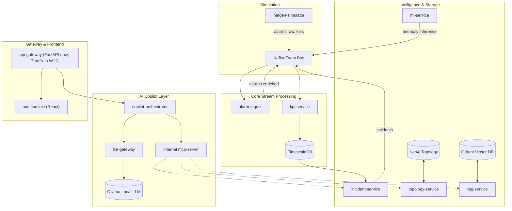

# 01 - Overview & Architecture

## What is NetSentinel?
NetSentinel is an AI-assisted Network Operations Center (NOC) copilot designed for telecom operators. It ingests synthetic network telemetry, correlates alarms and performance metrics, identifies root causes using topological knowledge graphs and vector RAG, and assists NOC engineers in resolving incidents rapidly.

**Important Note:** All data processed by NetSentinel is 100% synthetic. No real telecom subscriber or network data is ever used.

## Why Event-Driven Microservices?
Telecom networks produce continuous, high-volume streams of events (alarms, link state changes, KPI threshold violations). An event-driven architecture built on Apache Kafka ensures loose coupling, fault isolation, and real-time responsiveness across ingestion, streaming analytics, and AI copilot orchestration.

## Architecture Diagram

> **Security & Design Constraint:** The Model Context Protocol (MCP) server is strictly an internal tool layer called exclusively by the `copilot-orchestrator`. There are no external AI clients.

## Roadmap

| Phase | Steps (weeks) | Status |
|---|---|---|
| 1: interview-ready core | 1–12 | Done |
| 2: advanced AI | 13 incident-service, 14 topology-service, 15 Graph RAG, 16 ticket-service, 17 LangGraph copilot, 18 llm-gateway, 21 post-quantum | Steps 13–18 merged; Step 21 in review. **Not complete, so no `v0.2.0` tag yet** |
| 3: production and cloud | **19–20 TelcoGPT-mini (moved from Phase 2 on 2026-10-15)**, 22 observability, 23 k3d + Helm, 24 CI/CD and eval gates, 25–26 | Planned |

Step 21 was built straight after Step 18 and does not depend on TelcoGPT-mini. When Steps 19–20
land, llm-gateway gains a `telcogpt-mini` route and `scripts/sign_model.py` signs that release
the same way it signs the fault classifier today. The full plan is in `NetSentinel_Build_Plan.md`.

