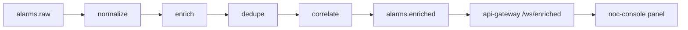
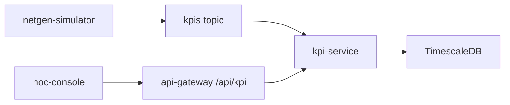
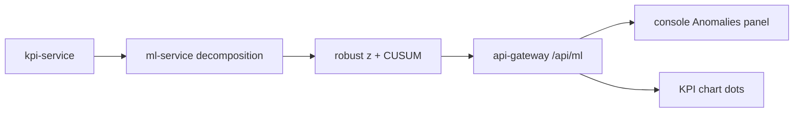

# 03 - Services Inventory

This document catalogs all services in the NetSentinel ecosystem, detailing their purpose, data flows, Kafka topics, environment variables and user‑facing interfaces.  
The **Week 3** additions are highlighted as **BUILT** and include short hand‑over notes for junior developers.

---

## Infrastructure Services (Week 1 – BUILT)

### 1. Apache Kafka (KRaft)
* **Status:** **BUILT**
* **Purpose:** Single‑node event streaming backbone.
* **Topics:** `alarms.raw`, `alarms.enriched`, `kpis`, `incidents`
* **Database:** N/A (event log)

### 2. TimescaleDB
* **Status:** **BUILT**
* **Purpose:** Time‑series storage for KPI telemetry and metric history.
* **Database:** PostgreSQL + TimescaleDB extension

---

## Library Packages (Week 2 – BUILT)

### libs/netgen
* **Status:** **BUILT**
* **Purpose:** Small pure‑Python library that models a synthetic telecom topology (sites, cells, fiber/microwave links) and provides a “fibre_cut” scenario generator.
* **Key Modules**
  * `netgen.topology` – data classes for `Site`, `Cell`, `FiberLink` and a helper to build a static graph.
  * `netgen.scenarios.fibre_cut` – `run(seed: int, speed: float, loop: bool, dry_run: bool)` yields alarm dictionaries matching the TMF642 shape.
* **CLI helpers** (exposed via the simulator):
  * `uv run netgen topology --seed 42 [--full] --out data/topology.json`
  * `uv run netgen kpis --seed 42 --days 1 [--full] --out -` (JSON‑lines)
* **Determinism:** Same seed → byte‑identical JSON output (checked with SHA‑256).  
* **Outputs:** Python objects that the simulator serialises to JSON and publishes to Kafka (`alarms.raw` for scenarios, `kpis` for telemetry).

---

## Core Micro‑services (Week 2 – BUILT)

### 3. netgen‑simulator
* **Status:** **BUILT**
* **Purpose:** CLI tool that drives the `libs/netgen` scenario engine and streams synthetic **alarms** *and* **KPIs** to Kafka. Acts as the “source of truth” for the demo.
* **Sub‑commands**
  ```bash
  # 1️⃣ Generate static topology JSON
  uv run netgen-sim topology \
      --seed 42 [--full] \
      --out data/topology.json

  # 2️⃣ Back‑fill KPI data (deterministic)
  uv run netgen-sim kpis \
      --seed 42 --days 7 [--full] \
      --out -          # writes JSON‑lines to stdout

  # 3️⃣ Live KPI feed (optional)
  uv run netgen-sim kpis \
      --seed 42 --days 7 [--full] \
      --follow --interval 5 \
      [--dry-run]      # prints to stdout instead of Kafka

  # 4️⃣ Alarm scenario (unchanged)
  uv run netgen-sim run \
      --seed 42 \
      --scenario fibre_cut \
      --speed 60x \
      [--loop] [--dry-run]
  ```
* **Inputs**
  * `--seed` – deterministic RNG seed (default 42).
  * `--days` – number of days to generate KPI samples.
  * `--full` – generate the full‑size topology (60 sites) instead of the small demo (12 sites).
  * `--follow` – after the back‑fill, keep publishing one sample per cell every `--interval` seconds (timestamp = now).
  * `--dry-run` – write JSON to stdout, do **not** connect to Kafka (useful for debugging).
* **Outputs**
  * **Alarms** → Kafka topic `alarms.raw`, key = `siteId`.
  * **KPIs** → Kafka topic `kpis`, key = `cellId`.
* **Environment Variables**
  * `KAFKA_BOOTSTRAP` – e.g. `kafka:29092`.
  * `ALARM_TOPIC` – defaults to `alarms.raw`.
  * `KPI_TOPIC` – defaults to `kpis`.
  * `DISABLE_KAFKA` – any non‑empty value disables Kafka connections (dry‑run mode).
* **How to run locally:** `make sim` (native) or `make sim-docker` (container).  
* **How to test:** `make test` runs the pytest suite that validates JSON schema, deterministic output and correct key handling.

### 4. api‑gateway
* **Status:** **BUILT**
* **Purpose:** Thin FastAPI façade that aggregates health information, exposes a small public API for the UI, and forwards raw alarm & KPI events from Kafka to WebSocket clients.
* **Key Endpoints**
  * `GET /health` – overall health JSON (same as Week 2).
  * `GET /api/topology` – Returns the topology JSON generated by `netgen-sim topology`.  
    *Environment:* `TOPOLOGY_SEED` (default 42) and `TOPOLOGY_FULL` (`0` = small, `1` = full).  
    *Behaviour:* Reads `data/topology.json` if present, otherwise generates on‑the‑fly using the same seed.
  * `GET /api/kpis/activity` – Returns a short snapshot of KPI activity:
    ```json
    {
      "totalSamples": 123456,
      "samplesPerMinute": 342,
      "lastSampleTime": "2026-10-14T09:15:00Z",
      "cellsReporting": 87
    }
    ```
  * `WebSocket /ws/alarms` – Same envelope as Week 2 (snapshot + incremental alarm messages).
  * `WebSocket /ws/kpis` – Sends a KPI activity message **every 2 seconds**:
    ```json
    {
      "type": "kpiActivity",
      "totalSamples": 123456,
      "ratePerMin": 342,
      "lastSampleTime": "2026-10-14T09:15:00Z",
      "lastSample": { …single KpiSample object… },
      "averages": {
        "dlThroughputMbps": 312.4,
        "prbUtilPct": 45.1,
        "rrcSetupSuccessPct": 98.2,
        "dropCallRatePct": 0.7,
        "availabilityPct": 99.5
      },
      "cellsReporting": 87
    }
    ```
* **Environment Variables**
  * `KAFKA_BOOTSTRAP`
  * `ALARM_TOPIC` (default `alarms.raw`)
  * `KPI_TOPIC` (default `kpis`)
  * `TOPOLOGY_SEED` – integer seed for deterministic topology generation.
  * `TOPOLOGY_FULL` – `0` (small) or `1` (full) size flag.
  * `DISABLE_KAFKA` – disables all Kafka consumers (useful for UI‑only demos).
* **How to run locally:** `make gateway` (starts `uvicorn` on `0.0.0.0:8000`).  
* **How to test:** `make test` runs FastAPI test client checks for health, topology, KPI activity and WebSocket handshakes.

### 5. noc‑console
* **Status:** **BUILT**
* **Purpose:** Front‑end dashboard (Vite + React + TypeScript + Tailwind) that visualises live alarms, KPI activity and a synthetic network map.
* **Running:** `npm run dev` serves UI on `http://localhost:5173`. Vite proxy forwards `/api/*`, `/health`, `/ws/*` to the locally running `api‑gateway` (`http://localhost:8000`).
* **Key UI Panels (Week 3)**
  * **Network Map** – SVG generated from `/api/topology`.  
    * Symbols:* core = square, hub = diamond, access = circle.  
    * Colour:* worst **ACTIVE** alarm severity per site (green = no active alarm, red = critical, orange = major, yellow = minor, blue = warning). Cleared alarms revert the site to green. Critical sites pulse. Hover tooltip shows site name, region and current alarm list.
  * **KPI Activity Panel** – Shows samples/min, total samples, cells reporting, last sample timestamp (badge turns **stale** after 60 s of no new data), and network‑wide averages displayed as horizontal bars.
  * **Clock & Timezone** – All timestamps are rendered in **IST (Asia/Kolkata)** with an “IST” label in the header clock, alarm table column header “Time (IST)” and KPI health badge “Last checked (IST)”.
* **How to add a new panel:** Create a React component under `src/components/`, import it in `src/App.tsx`, and wrap it with `<Panel title="…">`. No backend changes are required for static panels.
* **How to debug live data:** Open the browser dev‑tools → Network tab, filter for `ws/alarms` and `ws/kpis`. You’ll see the JSON envelopes described above.

---

## Pipeline Micro‑services (Weeks 4–5 – BUILT)

# Services Inventory – Week 4

### 6. alarm‑ingest (Week 4 – BUILT)

**Purpose**  
Consume raw alarms, normalise, enrich with topology, de‑duplicate, correlate and publish enriched alarms for downstream consumption.

**Inputs / Outputs**  

| Direction | Kafka Topic | Key | Value |
|-----------|-------------|-----|-------|
| **Consume** | `alarms.raw` | none (partition key not used) | raw alarm JSON |
| **Produce** | `alarms.enriched` | `siteId` | `EnrichedAlarm` JSON |

**Processing Stages**

1. **Normalize** – Validate `id`, `site`, `severity`. Map severity aliases (`crit`, `maj`, `min`, `warn`, `clear`, `indeterminate`) to canonical values. Convert `alarmRaisedTime` to UTC ISO‑8601 (`Z`). Invalid messages are counted in `stats.invalid` and dropped.
2. **Enrich** – Build the topology in memory with `netgen.build_topology(seed=TOPOLOGY_SEED)` (same seed as the gateway, so site ids match). Add `siteName`, `region`, `siteKind`, `nodeTypes`, `parentSiteId`, `known`. Unknown sites get `region: "Unknown"`.
3. **De‑duplicate** – Build a key `siteId|alarmType|probableCause|specificProblem`. Keep entries for 300 s. Emit a de‑dup record `{key, count, firstSeen, isDuplicate}`. A `clear` alarm removes active keys for the same `siteId` and `probableCause`.
4. **Correlate** – A critical alarm at site **X** creates a correlation group `corr-<alarm id>` that lives for 180 s. Subsequent alarms from **X** or any descendant in the topology receive role `symptom` with `rootSiteId: X`. Otherwise role is `none`.
5. **Publish** – Add `ingestedAt` (UTC, shown as IST in the console) and `@type: "EnrichedAlarm"` then publish to `alarms.enriched` keyed by `siteId`.

**Environment Variables**

| Variable | Description | Default |
|----------|-------------|---------|
| `KAFKA_BOOTSTRAP` | Kafka bootstrap servers | `localhost:9092` (compose: `kafka:29092`) |
| `RAW_TOPIC` | Raw alarm topic name | `alarms.raw` |
| `ENRICHED_TOPIC` | Enriched alarm topic name | `alarms.enriched` |
| `TOPOLOGY_SEED` | Topology seed (integer) | `42` |
| `TOPOLOGY_FULL` | `1` = full 60-site topology, `0` = small 12-site | `0` |
| `DISABLE_KAFKA` | If `1`, skip Kafka connection (useful for local dev) | `0` |
| `PORT` | FastAPI listen port | `8001` |

**Endpoints**

* `GET /healthz` – always 200.
* `GET /readyz` – 200 when Kafka is connected or `DISABLE_KAFKA=1`; otherwise 503.
* `GET /stats` – JSON with `received`, `published`, `invalid`, `duplicates`, `activeDedupKeys`.

**How to Run**

```bash
# Local development
make ingest          # runs uvicorn on :8001

# Full pipeline (docker compose)
make up-pipeline

# Stop everything
make down
```

**How to Test**

```bash
# Unit tests
uv run pytest services/alarm-ingest

# Stats endpoint
curl http://localhost:8001/stats

# Peek at enriched messages
make enriched-peek
```

**Debugging Tips**

* `/stats` shows counts; `duplicates` counts repeats inside the 300 s window; after a restart the windows start empty.
* `make enriched-peek` consumes a few messages from `alarms.enriched` and prints them.
* `GET /readyz` returning 503 means the service cannot reach Kafka. Check network and broker logs.
* Consumer group lag:  
  ```bash
  kafka-consumer-groups.sh --bootstrap-server $KAFKA_BOOTSTRAP \
    --describe --group alarm-ingest
  ```

**Data flow**



---

### 7. kpi-service (Week 5 – BUILT)

**Purpose**  
Consume KPI samples from Kafka, store them in a TimescaleDB hypertable, and expose read‑only HTTP endpoints for the NOC console.

#### Inputs / Outputs

| Direction | System                | Interface / Format                     |
|-----------|-----------------------|----------------------------------------|
| Input     | `kpis` Kafka topic    | JSON messages, fields: `cellId`, `siteId`, `region`, `ts` (ISO‑8601 IST), `dlThroughputMbps`, `prbUtilPct`, `rrcSetupSuccessPct`, `dropCallRatePct`, `availabilityPct` |
| Output    | TimescaleDB `kpi_samples` | Table rows (UTC timestamps) |
| Output    | FastAPI HTTP endpoints | JSON responses (see *Endpoints* section) |

#### Database Schema

| Table | Columns | Description |
|-------|---------|-------------|
| `kpi_samples` (hypertable) | `cell_id` **TEXT** PK part | Identifier of the cell |
| | `ts` **TIMESTAMPTZ** PK part | Sample timestamp (stored in UTC) |
| | `site_id` **TEXT** | Site identifier |
| | `region` **TEXT** | Geographic region |
| | `dl_throughput_mbps` **DOUBLE PRECISION** | Downlink throughput |
| | `prb_util_pct` **DOUBLE PRECISION** |
| | `rrc_setup_success_pct` **DOUBLE PRECISION** |
| | `drop_call_rate_pct` **DOUBLE PRECISION** |
| | `availability_pct` **DOUBLE PRECISION** |
| Indexes | `PRIMARY KEY (cell_id, ts)` | Guarantees idempotent inserts |
| | `INDEX ON cell_id` | Fast lookup per cell |
| | `INDEX ON ts DESC` | Recent‑sample queries |

#### API Endpoints

| Method | Path | Query Params | Description |
|--------|------|--------------|-------------|
| `GET` | `/healthz` | – | Returns `200 OK` if the process is alive. |
| `GET` | `/readyz` | – | Returns `200 OK` only when DB and Kafka are reachable; otherwise `503`. |
| `GET` | `/stats` | – | `{received, written, invalid}` counters. |
| `GET` | `/kpis/cells` | `limit` (default 500) | List of cells with latest timestamp and sample count. |
| `GET` | `/kpis/cells/{cellId}` | `from`, `to` (ISO‑8601 UTC, e.g. `2026-10-14T09:00:00Z`), `agg` (`raw`, `15m`, `1h`, `1d`) | Time‑series points for a single cell. Aggregation uses `time_bucket` + `AVG`. Default: last 24 h. Max range: 62 days. Invalid params → `422`. |

#### Environment Variables

| Variable | Default | Description |
|----------|---------|-------------|
| `KAFKA_BOOTSTRAP` | `localhost:9092` | Kafka bootstrap servers |
| `KPI_TOPIC` | `kpis` | Kafka topic name |
| `KPI_STORE` | `postgres` | `postgres` or `memory` (test mode) |
| `TIMESCALE_HOST` | `localhost` | TimescaleDB host |
| `TIMESCALE_PORT` | `5432` | TimescaleDB port |
| `POSTGRES_USER` | `postgres` | DB user |
| `POSTGRES_PASSWORD` | – (from `.env`) | DB password |
| `POSTGRES_DB` | `postgres` | Database name |
| `DATABASE_URL` | – | If set, overrides the assembled URL |
| `DISABLE_KAFKA` | – | If set, the consumer is disabled (useful for dev) |
| `PORT` | `8002` | HTTP listen port |
| `KPI_SERVICE_URL` | `http://localhost:8002` | Used by the API‑gateway to proxy requests |

#### Run / Test / Debug

```bash
# Start the service (reads .env)
make kpi-service

# Show DB row count
docker compose exec timescaledb \
  psql -U postgres -c "SELECT COUNT(*) FROM kpi_samples;"

# Check consumer lag
docker compose exec kafka \
  kafka-consumer-groups.sh --bootstrap-server localhost:9092 \
  --describe --group kpi-service

# Run KPI‑service stats helper (prints received / written counters)
make kpi-stats

# Run unit tests
pytest -q src/kpi_service/tests

# Run linter / type‑checker
ruff check src/kpi_service
mypy src/kpi_service
```

#### Architecture Diagram




### 8. ml-service (Week 6 – BUILT)

#### Purpose
`ml-service` provides statistical anomaly detection for KPI time‑series.  
It fetches 15‑minute KPI data from **kpi‑service**, builds a simple STL‑like baseline (trend + seasonal), computes a robust Z‑score and a CUSUM alarm, and returns the points that exceed the configured thresholds.

#### How detection works (step‑by‑step)
1. **Fetch data** – The service calls `GET /kpis/{cellId}?kpi={kpi}&hours=N` on `kpi-service`.  
2. **Build baseline** –  
   * If ≥ 2 days of data:  
     * Trend = centred rolling median over 1 day (96 points).  
     * Seasonal = median of detrended values for each of the 96 phase positions.  
   * If < 2 days: trend = centred 3 h rolling median, no seasonal term.  
3. **Compute residuals** – `residual = raw – trend – seasonal`.  
4. **Robust Z‑score** – `z = (residual - median(residual)) / (1.4826 * MAD)`.  
   * If MAD = 0, replace denominator with `1.2533 * mean(|residual - median|)`.  
5. **CUSUM** – Apply a two‑sided CUSUM on the Z‑score series (`k=0.5`, `h=5`).  
6. **Flag anomalies** – A point is an anomaly when `|z| > ANOMALY_Z` (default 3.5) **or** CUSUM raises an alarm.  
7. **Return JSON** – Each anomaly includes cell, timestamp (converted to IST for operators), score, direction, and method (`zscore`, `cusum`, or `both`).

#### Endpoints
| Method | Path | Description |
|--------|------|-------------|
| `GET` | `/healthz` | Always returns 200. |
| `GET` | `/readyz` | 200 if `kpi-service` reachable, otherwise 503. |
| `GET` | `/anomalies/cells/{cellId}` | Query anomalies for a single cell. Parameters: `kpi` (required), `hours` (default 168). |
| `GET` | `/anomalies` | Scan up to 20 cells, sort by score descending. Params: `kpi` (required), `hours` (default 24), `limit` (default 50). |

#### Environment variables
| Variable | Default | Meaning |
|----------|---------|---------|
| `KPI_SERVICE_URL` | `http://localhost:8002` | Base URL of the KPI service. |
| `ANOMALY_Z` | `3.5` | Z‑score threshold for flagging. |
| `PORT` | `8003` | HTTP port the FastAPI app listens on. |
| `MLFLOW_TRACKING_URI` | *(unset)* | If set and `mlflow` is installed, runs are logged to MLflow. |

#### Run / Test / Debug commands
```bash
# Start the service (uvicorn) – uses the "pipeline" compose profile
make ml               # uvicorn services.ml_service.main:app --host 0.0.0.0 --port 8003

# Train baselines (synthetic data) – creates a JSON run log
make ml-train        # uv run python -m ml_service.train_baselines --experiment anomaly-baselines --seed 42 --days 7

# Quick sanity check – call the gateway proxy
make anomalies       # curl http://localhost:8000/api/ml/anomalies?kpi=dlThroughputMbps&hours=24

# Run unit tests
uv run pytest services/ml-service

# Direct health/readiness checks
curl http://localhost:8003/healthz
curl http://localhost:8003/readyz
```

#### Reading the score
The JSON field `score` is the absolute robust Z‑score.  
* **Red** badge in the console: `z ≥ 6`.  
* **Orange** badge: `4 ≤ z < 6`.  
* **Amber** badge: `3.5 ≤ z < 4`.  
The `method` field tells whether the flag came from `zscore`, `cusum`, or `both`. The `direction` field (`high` / `low`) indicates whether the KPI is unusually high or low.

#### Architecture diagram


---

## Planned Micro‑services (Phase 1 & 2 – PLANNED)

*(Unchanged from previous weeks; retained for roadmap visibility.)*

### 8. incident‑service
* **Status:** PLANNED
* **Purpose:** Correlates enriched alarms and KPIs into incidents.

### 9. topology‑service
* **Status:** PLANNED
* **Purpose:** Maintains network topology graph (Neo4j).

### 10. rag‑service
* **Status:** PLANNED
* **Purpose:** Semantic search over historical incidents and runbooks.

### 12. mcp‑server (Internal)
* **Status:** PLANNED
* **Purpose:** Internal Model Context Protocol server.

### 13. copilot‑orchestrator
* **Status:** PLANNED
* **Purpose:** LLM‑driven query handling for operators.

### 14. llm‑gateway
* **Status:** PLANNED
* **Purpose:** Proxy for local Ollama or hosted LLM endpoints.

### 15. ticket‑service
* **Status:** PLANNED
* **Purpose:** Mock integration with external ticketing systems.

### 16. api‑gateway – Traefik edge (planned, Week 11)
* **Status:** PLANNED
* **Purpose:** Full‑featured reverse‑proxy for HTTP/WebSocket traffic (will replace the thin FastAPI gateway).

### 17. noc‑console – full UI (later weeks)
* **Status:** PLANNED
* **Purpose:** Full NOC UI with topology map, incident view, and copilot chat.

--- 

*All Week 3 items are marked **BUILT** and ready for junior developers to explore, run, and extend.*

## ml-service: fault classifier (W7)

- **Port:** `8003` (FastAPI)  
- **Endpoints**  
  - `POST /predict`  
    - **Request body:** `{ "alarm": <enriched_alarm>, "context": <optional> }`  
    - **Response:** `{ "faultType": "<type>", "confidence": <0‑1>, "probabilities": { "<type>": <p>, … }, "modelVersion": "<hash>" }`  
  - `POST /explain?top_k=5` (allowed 1‑20)  
    - **Request body:** same as `/predict`  
    - **Response:** `{ "faultType": "<type>", "confidence": <0‑1>, "modelVersion": "<hash>", "baseValue": <float>, "contributions": [ { "feature": "<name>", "value": <numeric>, "shap": <float> }, … ] }`  

- **Model handling**  
  - Models are stored under `MODELS_DIR` (default `models`).  
  - Registry file: `models/registry.json`.  
  - `MODEL_NAME` env var selects which registered model to load.  
  - `AUTO_TRAIN=1` (default) → if no model is present, a tiny synthetic model is trained on first request.  
  - `AUTO_TRAIN=0` → `/predict` and `/explain` return **503 Service Unavailable**.  

- **Explanation engine** uses XGBoost’s built‑in TreeSHAP (`predict(pred_contribs=True)`). No external `shap` dependency.  

- **Integration**  
  - The `api-gateway` proxies `POST /api/ml/predict` and `POST /api/ml/explain` to this service.  
  - NOC console renders the fault badge and a side‑panel (`ShapDrawer`) with the top SHAP contributions as horizontal bars.

## rag-service (W8)

- **Framework**: FastAPI, listening on **port 8004**.  
- **Compose profile**: `rag`.  
- **Dependencies**:  
  - `qdrant/qdrant:v1.12.4` container exposing **:6333**.  
  - Volume `qdrant-data` for persistent storage.  
- **Embedding options**:  
  - Default: deterministic `hash-384`.  
  - Optional: `EMBEDDER=fastembed` to use BAAI/bge‑small‑en‑v1.5 (install with `uv sync --extra embed`).  
- **Endpoints**:  
  - `GET /healthz` – health check.  
  - `GET /readyz` – returns **503** until the ingest pipeline finishes successfully.  
  - `POST /search` – body `{query:string, top_k?:int, mode?:string, faultType?:string}`. Returns a JSON payload with the query, mode, embedder used, and an array of results (`runbookId`, `title`, `section`, `snippet`, `score`, `faultType`).  
  - `GET /runbooks/{id}` – returns the full markdown runbook and its front‑matter.  
- **Gateway proxies** (via the NOC gateway on port 8000):  
  - `POST /api/rag/search` – forwards to `rag-service`. Returns **413** if request body > 16 KB, **503** if `rag-service` is down, **502** for non‑JSON payloads.  
  - `GET /api/rag/runbooks/{id}` – validates `id` against the regex `^RB-[A-Z]{3}-\d{3}$`; otherwise returns **404**.  

The service ingests the synthetic runbooks (42 markdown files under `data/runbooks`) by chunking each `##` section, generating deterministic chunk IDs, and storing vectors in Qdrant with cosine distance.  Re‑ingest is idempotent because Qdrant point IDs are derived from `uuid5(chunk_id)`.

## copilot-orchestrator (W9)

The **copilot-orchestrator** service provides the AI‑driven analysis for Step 9 of the NetSentinel demo.

| Attribute | Value |
|-----------|-------|
| **Service name** | `copilot-orchestrator` |
| **Framework** | FastAPI |
| **Port** | 8005 |
| **Compose profile** | `copilot` |
| **Memory limit** | 128 MiB |
| **Implementation** | Plain async Python (no LangGraph/LangChain) |
| **Endpoints** | `POST /analyze` – request analysis<br>`GET /healthz` – health check<br>`GET /readyz` – readiness (reports LLM name) |
| **LLM** | Local Ollama (`OLLAMA_URL`, default `http://localhost:11434`)<br>Model: `qwen2.5:1.5b` (configurable via `OLLAMA_MODEL`) |
| **Retry policy** | Up to 3 attempts; validation errors are fed back into the next prompt. No retry if Ollama is unreachable. |
| **Fallback** | Deterministic answer built from gathered evidence, marked `generatedBy: "fallback"` |
| **Upstream dependencies** | `gateway` (alarms), `ml-service` (anomalies & fault type), `rag-service` (runbooks) |
| **Error handling** | Upstream failures become `warnings` in the response; HTTP 404 for “no alarms”, 422 for bad input, 503 if the service itself is down, 502 on non‑JSON from gateway. |
| **Testing** | Unit tests + CI e2e fibre‑cut test with mocked HTTP and a MockLLM. OpenAPI contract kept in `contracts/openapi/copilot-orchestrator.yaml`. |
