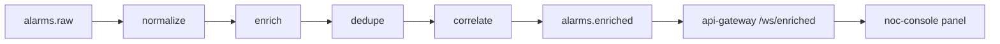
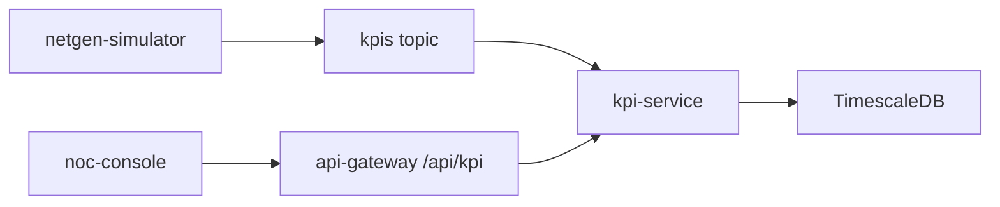
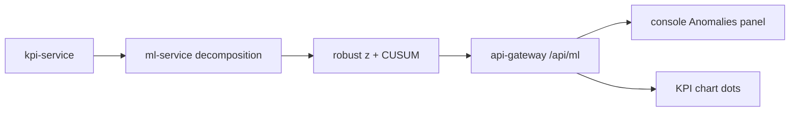
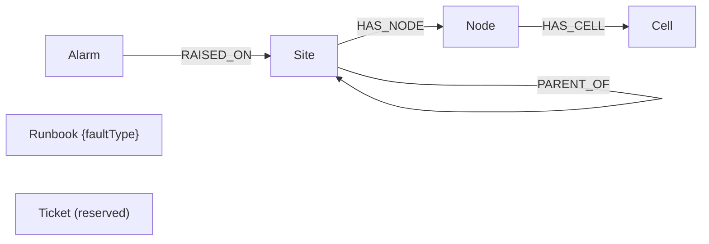

# 03 - Services Inventory

This document catalogs all services in the NetSentinel ecosystem, detailing their purpose, data flows, Kafka topics, environment variables and user‑facing interfaces.  
The **Week 3** additions are highlighted as **BUILT** and include short hand‑over notes for junior developers.

---

## Infrastructure Services (Week 1 – BUILT)

### 1. Apache Kafka (KRaft)
* **Status:** **BUILT**
* **Purpose:** Single‑node event streaming backbone.
* **Topics:** `alarms.raw`, `alarms.enriched`, `kpis`, `incidents`
* **Database:** N/A (event log)

### 2. TimescaleDB
* **Status:** **BUILT**
* **Purpose:** Time‑series storage for KPI telemetry and metric history.
* **Database:** PostgreSQL + TimescaleDB extension

---

## Library Packages (Week 2 – BUILT)

### libs/netgen
* **Status:** **BUILT**
* **Purpose:** Small pure‑Python library that models a synthetic telecom topology (sites, cells, fiber/microwave links) and provides a “fibre_cut” scenario generator.
* **Key Modules**
  * `netgen.topology` – data classes for `Site`, `Cell`, `FiberLink` and a helper to build a static graph.
  * `netgen.scenarios.fibre_cut` – `run(seed: int, speed: float, loop: bool, dry_run: bool)` yields alarm dictionaries matching the TMF642 shape.
* **CLI helpers** (exposed via the simulator):
  * `uv run netgen topology --seed 42 [--full] --out data/topology.json`
  * `uv run netgen kpis --seed 42 --days 1 [--full] --out -` (JSON‑lines)
* **Determinism:** Same seed → byte‑identical JSON output (checked with SHA‑256).  
* **Outputs:** Python objects that the simulator serialises to JSON and publishes to Kafka (`alarms.raw` for scenarios, `kpis` for telemetry).

---

## Core Micro‑services (Week 2 – BUILT)

### 3. netgen‑simulator
* **Status:** **BUILT**
* **Purpose:** CLI tool that drives the `libs/netgen` scenario engine and streams synthetic **alarms** *and* **KPIs** to Kafka. Acts as the “source of truth” for the demo.
* **Sub‑commands**
  ```bash
  # 1️⃣ Generate static topology JSON
  uv run netgen-sim topology \
      --seed 42 [--full] \
      --out data/topology.json

  # 2️⃣ Back‑fill KPI data (deterministic)
  uv run netgen-sim kpis \
      --seed 42 --days 7 [--full] \
      --out -          # writes JSON‑lines to stdout

  # 3️⃣ Live KPI feed (optional)
  uv run netgen-sim kpis \
      --seed 42 --days 7 [--full] \
      --follow --interval 5 \
      [--dry-run]      # prints to stdout instead of Kafka

  # 4️⃣ Alarm scenario (unchanged)
  uv run netgen-sim run \
      --seed 42 \
      --scenario fibre_cut \
      --speed 60x \
      [--loop] [--dry-run]
  ```
* **Inputs**
  * `--seed` – deterministic RNG seed (default 42).
  * `--days` – number of days to generate KPI samples.
  * `--full` – generate the full‑size topology (60 sites) instead of the small demo (12 sites).
  * `--follow` – after the back‑fill, keep publishing one sample per cell every `--interval` seconds (timestamp = now).
  * `--dry-run` – write JSON to stdout, do **not** connect to Kafka (useful for debugging).
* **Outputs**
  * **Alarms** → Kafka topic `alarms.raw`, key = `siteId`.
  * **KPIs** → Kafka topic `kpis`, key = `cellId`.
* **Environment Variables**
  * `KAFKA_BOOTSTRAP` – e.g. `kafka:29092`.
  * `ALARM_TOPIC` – defaults to `alarms.raw`.
  * `KPI_TOPIC` – defaults to `kpis`.
  * `DISABLE_KAFKA` – any non‑empty value disables Kafka connections (dry‑run mode).
* **How to run locally:** `make sim` (native) or `make sim-docker` (container).  
* **How to test:** `make test` runs the pytest suite that validates JSON schema, deterministic output and correct key handling.

### 4. api‑gateway
* **Status:** **BUILT**
* **Purpose:** Thin FastAPI façade that aggregates health information, exposes a small public API for the UI, and forwards raw alarm & KPI events from Kafka to WebSocket clients.
* **Key Endpoints**
  * `GET /health` – overall health JSON (same as Week 2).
  * `GET /api/topology` – Returns the topology JSON generated by `netgen-sim topology`.  
    *Environment:* `TOPOLOGY_SEED` (default 42) and `TOPOLOGY_FULL` (`0` = small, `1` = full).  
    *Behaviour:* Reads `data/topology.json` if present, otherwise generates on‑the‑fly using the same seed.
  * `GET /api/kpis/activity` – Returns a short snapshot of KPI activity:
    ```json
    {
      "totalSamples": 123456,
      "samplesPerMinute": 342,
      "lastSampleTime": "2026-10-14T09:15:00Z",
      "cellsReporting": 87
    }
    ```
  * `WebSocket /ws/alarms` – Same envelope as Week 2 (snapshot + incremental alarm messages).
  * `WebSocket /ws/kpis` – Sends a KPI activity message **every 2 seconds**:
    ```json
    {
      "type": "kpiActivity",
      "totalSamples": 123456,
      "ratePerMin": 342,
      "lastSampleTime": "2026-10-14T09:15:00Z",
      "lastSample": { …single KpiSample object… },
      "averages": {
        "dlThroughputMbps": 312.4,
        "prbUtilPct": 45.1,
        "rrcSetupSuccessPct": 98.2,
        "dropCallRatePct": 0.7,
        "availabilityPct": 99.5
      },
      "cellsReporting": 87
    }
    ```
* **Environment Variables**
  * `KAFKA_BOOTSTRAP`
  * `ALARM_TOPIC` (default `alarms.raw`)
  * `KPI_TOPIC` (default `kpis`)
  * `TOPOLOGY_SEED` – integer seed for deterministic topology generation.
  * `TOPOLOGY_FULL` – `0` (small) or `1` (full) size flag.
  * `DISABLE_KAFKA` – disables all Kafka consumers (useful for UI‑only demos).
* **How to run locally:** `make gateway` (starts `uvicorn` on `0.0.0.0:8000`).  
* **How to test:** `make test` runs FastAPI test client checks for health, topology, KPI activity and WebSocket handshakes.

### 5. noc‑console
* **Status:** **BUILT**
* **Purpose:** Front‑end dashboard (Vite + React + TypeScript + Tailwind) that visualises live alarms, KPI activity and a synthetic network map.
* **Running:** `npm run dev` serves UI on `http://localhost:5173`. Vite proxy forwards `/api/*`, `/health`, `/ws/*` to the locally running `api‑gateway` (`http://localhost:8000`).
* **Key UI Panels (Week 3)**
  * **Network Map** – SVG generated from `/api/topology`.  
    * Symbols:* core = square, hub = diamond, access = circle.  
    * Colour:* worst **ACTIVE** alarm severity per site (green = no active alarm, red = critical, orange = major, yellow = minor, blue = warning). Cleared alarms revert the site to green. Critical sites pulse. Hover tooltip shows site name, region and current alarm list.
  * **KPI Activity Panel** – Shows samples/min, total samples, cells reporting, last sample timestamp (badge turns **stale** after 60 s of no new data), and network‑wide averages displayed as horizontal bars.
  * **Clock & Timezone** – All timestamps are rendered in **IST (Asia/Kolkata)** with an “IST” label in the header clock, alarm table column header “Time (IST)” and KPI health badge “Last checked (IST)”.
* **How to add a new panel:** Create a React component under `src/components/`, import it in `src/App.tsx`, and wrap it with `<Panel title="…">`. No backend changes are required for static panels.
* **How to debug live data:** Open the browser dev‑tools → Network tab, filter for `ws/alarms` and `ws/kpis`. You’ll see the JSON envelopes described above.

---

## Pipeline Micro‑services (Weeks 4–5 – BUILT)

# Services Inventory – Week 4

### 6. alarm‑ingest (Week 4 – BUILT)

**Purpose**  
Consume raw alarms, normalise, enrich with topology, de‑duplicate, correlate and publish enriched alarms for downstream consumption.

**Inputs / Outputs**  

| Direction | Kafka Topic | Key | Value |
|-----------|-------------|-----|-------|
| **Consume** | `alarms.raw` | none (partition key not used) | raw alarm JSON |
| **Produce** | `alarms.enriched` | `siteId` | `EnrichedAlarm` JSON |

**Processing Stages**

1. **Normalize** – Validate `id`, `site`, `severity`. Map severity aliases (`crit`, `maj`, `min`, `warn`, `clear`, `indeterminate`) to canonical values. Convert `alarmRaisedTime` to UTC ISO‑8601 (`Z`). Invalid messages are counted in `stats.invalid` and dropped.
2. **Enrich** – Build the topology in memory with `netgen.build_topology(seed=TOPOLOGY_SEED)` (same seed as the gateway, so site ids match). Add `siteName`, `region`, `siteKind`, `nodeTypes`, `parentSiteId`, `known`. Unknown sites get `region: "Unknown"`.
3. **De‑duplicate** – Build a key `siteId|alarmType|probableCause|specificProblem`. Keep entries for 300 s. Emit a de‑dup record `{key, count, firstSeen, isDuplicate}`. A `clear` alarm removes active keys for the same `siteId` and `probableCause`.
4. **Correlate** – A critical alarm at site **X** creates a correlation group `corr-<alarm id>` that lives for 180 s. Subsequent alarms from **X** or any descendant in the topology receive role `symptom` with `rootSiteId: X`. Otherwise role is `none`.
5. **Publish** – Add `ingestedAt` (UTC, shown as IST in the console) and `@type: "EnrichedAlarm"` then publish to `alarms.enriched` keyed by `siteId`.

**Environment Variables**

| Variable | Description | Default |
|----------|-------------|---------|
| `KAFKA_BOOTSTRAP` | Kafka bootstrap servers | `localhost:9092` (compose: `kafka:29092`) |
| `RAW_TOPIC` | Raw alarm topic name | `alarms.raw` |
| `ENRICHED_TOPIC` | Enriched alarm topic name | `alarms.enriched` |
| `TOPOLOGY_SEED` | Topology seed (integer) | `42` |
| `TOPOLOGY_FULL` | `1` = full 60-site topology, `0` = small 12-site | `0` |
| `DISABLE_KAFKA` | If `1`, skip Kafka connection (useful for local dev) | `0` |
| `PORT` | FastAPI listen port | `8001` |

**Endpoints**

* `GET /healthz` – always 200.
* `GET /readyz` – 200 when Kafka is connected or `DISABLE_KAFKA=1`; otherwise 503.
* `GET /stats` – JSON with `received`, `published`, `invalid`, `duplicates`, `activeDedupKeys`.

**How to Run**

```bash
# Local development
make ingest          # runs uvicorn on :8001

# Full pipeline (docker compose)
make up-pipeline

# Stop everything
make down
```

**How to Test**

```bash
# Unit tests
uv run pytest services/alarm-ingest

# Stats endpoint
curl http://localhost:8001/stats

# Peek at enriched messages
make enriched-peek
```

**Debugging Tips**

* `/stats` shows counts; `duplicates` counts repeats inside the 300 s window; after a restart the windows start empty.
* `make enriched-peek` consumes a few messages from `alarms.enriched` and prints them.
* `GET /readyz` returning 503 means the service cannot reach Kafka. Check network and broker logs.
* Consumer group lag:  
  ```bash
  kafka-consumer-groups.sh --bootstrap-server $KAFKA_BOOTSTRAP \
    --describe --group alarm-ingest
  ```

**Data flow**



---

### 7. kpi-service (Week 5 – BUILT)

**Purpose**  
Consume KPI samples from Kafka, store them in a TimescaleDB hypertable, and expose read‑only HTTP endpoints for the NOC console.

#### Inputs / Outputs

| Direction | System                | Interface / Format                     |
|-----------|-----------------------|----------------------------------------|
| Input     | `kpis` Kafka topic    | JSON messages, fields: `cellId`, `siteId`, `region`, `ts` (ISO‑8601 IST), `dlThroughputMbps`, `prbUtilPct`, `rrcSetupSuccessPct`, `dropCallRatePct`, `availabilityPct` |
| Output    | TimescaleDB `kpi_samples` | Table rows (UTC timestamps) |
| Output    | FastAPI HTTP endpoints | JSON responses (see *Endpoints* section) |

#### Database Schema

| Table | Columns | Description |
|-------|---------|-------------|
| `kpi_samples` (hypertable) | `cell_id` **TEXT** PK part | Identifier of the cell |
| | `ts` **TIMESTAMPTZ** PK part | Sample timestamp (stored in UTC) |
| | `site_id` **TEXT** | Site identifier |
| | `region` **TEXT** | Geographic region |
| | `dl_throughput_mbps` **DOUBLE PRECISION** | Downlink throughput |
| | `prb_util_pct` **DOUBLE PRECISION** |
| | `rrc_setup_success_pct` **DOUBLE PRECISION** |
| | `drop_call_rate_pct` **DOUBLE PRECISION** |
| | `availability_pct` **DOUBLE PRECISION** |
| Indexes | `PRIMARY KEY (cell_id, ts)` | Guarantees idempotent inserts |
| | `INDEX ON cell_id` | Fast lookup per cell |
| | `INDEX ON ts DESC` | Recent‑sample queries |

#### API Endpoints

| Method | Path | Query Params | Description |
|--------|------|--------------|-------------|
| `GET` | `/healthz` | – | Returns `200 OK` if the process is alive. |
| `GET` | `/readyz` | – | Returns `200 OK` only when DB and Kafka are reachable; otherwise `503`. |
| `GET` | `/stats` | – | `{received, written, invalid}` counters. |
| `GET` | `/kpis/cells` | `limit` (default 500) | List of cells with latest timestamp and sample count. |
| `GET` | `/kpis/cells/{cellId}` | `from`, `to` (ISO‑8601 UTC, e.g. `2026-10-14T09:00:00Z`), `agg` (`raw`, `15m`, `1h`, `1d`) | Time‑series points for a single cell. Aggregation uses `time_bucket` + `AVG`. Default: last 24 h. Max range: 62 days. Invalid params → `422`. |

#### Environment Variables

| Variable | Default | Description |
|----------|---------|-------------|
| `KAFKA_BOOTSTRAP` | `localhost:9092` | Kafka bootstrap servers |
| `KPI_TOPIC` | `kpis` | Kafka topic name |
| `KPI_STORE` | `postgres` | `postgres` or `memory` (test mode) |
| `TIMESCALE_HOST` | `localhost` | TimescaleDB host |
| `TIMESCALE_PORT` | `5432` | TimescaleDB port |
| `POSTGRES_USER` | `postgres` | DB user |
| `POSTGRES_PASSWORD` | – (from `.env`) | DB password |
| `POSTGRES_DB` | `postgres` | Database name |
| `DATABASE_URL` | – | If set, overrides the assembled URL |
| `DISABLE_KAFKA` | – | If set, the consumer is disabled (useful for dev) |
| `PORT` | `8002` | HTTP listen port |
| `KPI_SERVICE_URL` | `http://localhost:8002` | Used by the API‑gateway to proxy requests |

#### Run / Test / Debug

```bash
# Start the service (reads .env)
make kpi-service

# Show DB row count
docker compose exec timescaledb \
  psql -U postgres -c "SELECT COUNT(*) FROM kpi_samples;"

# Check consumer lag
docker compose exec kafka \
  kafka-consumer-groups.sh --bootstrap-server localhost:9092 \
  --describe --group kpi-service

# Run KPI‑service stats helper (prints received / written counters)
make kpi-stats

# Run unit tests
pytest -q src/kpi_service/tests

# Run linter / type‑checker
ruff check src/kpi_service
mypy src/kpi_service
```

#### Architecture Diagram




### 8. ml-service (Week 6 – BUILT)

#### Purpose
`ml-service` provides statistical anomaly detection for KPI time‑series.  
It fetches 15‑minute KPI data from **kpi‑service**, builds a simple STL‑like baseline (trend + seasonal), computes a robust Z‑score and a CUSUM alarm, and returns the points that exceed the configured thresholds.

#### How detection works (step‑by‑step)
1. **Fetch data** – The service calls `GET /kpis/{cellId}?kpi={kpi}&hours=N` on `kpi-service`.  
2. **Build baseline** –  
   * If ≥ 2 days of data:  
     * Trend = centred rolling median over 1 day (96 points).  
     * Seasonal = median of detrended values for each of the 96 phase positions.  
   * If < 2 days: trend = centred 3 h rolling median, no seasonal term.  
3. **Compute residuals** – `residual = raw – trend – seasonal`.  
4. **Robust Z‑score** – `z = (residual - median(residual)) / (1.4826 * MAD)`.  
   * If MAD = 0, replace denominator with `1.2533 * mean(|residual - median|)`.  
5. **CUSUM** – Apply a two‑sided CUSUM on the Z‑score series (`k=0.5`, `h=5`).  
6. **Flag anomalies** – A point is an anomaly when `|z| > ANOMALY_Z` (default 3.5) **or** CUSUM raises an alarm.  
7. **Return JSON** – Each anomaly includes cell, timestamp (converted to IST for operators), score, direction, and method (`zscore`, `cusum`, or `both`).

#### Endpoints
| Method | Path | Description |
|--------|------|-------------|
| `GET` | `/healthz` | Always returns 200. |
| `GET` | `/readyz` | 200 if `kpi-service` reachable, otherwise 503. |
| `GET` | `/anomalies/cells/{cellId}` | Query anomalies for a single cell. Parameters: `kpi` (required), `hours` (default 168). |
| `GET` | `/anomalies` | Scan up to 20 cells, sort by score descending. Params: `kpi` (required), `hours` (default 24), `limit` (default 50). |

#### Environment variables
| Variable | Default | Meaning |
|----------|---------|---------|
| `KPI_SERVICE_URL` | `http://localhost:8002` | Base URL of the KPI service. |
| `ANOMALY_Z` | `3.5` | Z‑score threshold for flagging. |
| `PORT` | `8003` | HTTP port the FastAPI app listens on. |
| `MLFLOW_TRACKING_URI` | *(unset)* | If set and `mlflow` is installed, runs are logged to MLflow. |

#### Run / Test / Debug commands
```bash
# Start the service (uvicorn) – uses the "pipeline" compose profile
make ml               # uvicorn services.ml_service.main:app --host 0.0.0.0 --port 8003

# Train baselines (synthetic data) – creates a JSON run log
make ml-train        # uv run python -m ml_service.train_baselines --experiment anomaly-baselines --seed 42 --days 7

# Quick sanity check – call the gateway proxy
make anomalies       # curl http://localhost:8000/api/ml/anomalies?kpi=dlThroughputMbps&hours=24

# Run unit tests
uv run pytest services/ml-service

# Direct health/readiness checks
curl http://localhost:8003/healthz
curl http://localhost:8003/readyz
```

#### Reading the score
The JSON field `score` is the absolute robust Z‑score.  
* **Red** badge in the console: `z ≥ 6`.  
* **Orange** badge: `4 ≤ z < 6`.  
* **Amber** badge: `3.5 ≤ z < 4`.  
The `method` field tells whether the flag came from `zscore`, `cusum`, or `both`. The `direction` field (`high` / `low`) indicates whether the KPI is unusually high or low.

#### Architecture diagram


---

## Planned Micro‑services (Phase 1 & 2 – PLANNED)

*(Unchanged from previous weeks; retained for roadmap visibility.)*

### 8. incident‑service
* **Status:** PLANNED
* **Purpose:** Correlates enriched alarms and KPIs into incidents.

### 9. topology‑service
* **Status:** PLANNED
* **Purpose:** Maintains network topology graph (Neo4j).

### 10. rag‑service
* **Status:** PLANNED
* **Purpose:** Semantic search over historical incidents and runbooks.

### 12. mcp‑server (Internal)
* **Status:** PLANNED
* **Purpose:** Internal Model Context Protocol server.

### 13. copilot‑orchestrator
* **Status:** PLANNED
* **Purpose:** LLM‑driven query handling for operators.

### 14. llm‑gateway
* **Status:** PLANNED
* **Purpose:** Proxy for local Ollama or hosted LLM endpoints.

### 15. ticket‑service
* **Status:** PLANNED
* **Purpose:** Mock integration with external ticketing systems.

### 16. api‑gateway – Traefik edge (planned, Week 11)
* **Status:** PLANNED
* **Purpose:** Full‑featured reverse‑proxy for HTTP/WebSocket traffic (will replace the thin FastAPI gateway).

### 17. noc‑console – full UI (later weeks)
* **Status:** PLANNED
* **Purpose:** Full NOC UI with topology map, incident view, and copilot chat.

--- 

*All Week 3 items are marked **BUILT** and ready for junior developers to explore, run, and extend.*

## ml-service: fault classifier (W7)

- **Port:** `8003` (FastAPI)  
- **Endpoints**  
  - `POST /predict`  
    - **Request body:** `{ "alarm": <enriched_alarm>, "context": <optional> }`  
    - **Response:** `{ "faultType": "<type>", "confidence": <0‑1>, "probabilities": { "<type>": <p>, … }, "modelVersion": "<hash>" }`  
  - `POST /explain?top_k=5` (allowed 1‑20)  
    - **Request body:** same as `/predict`  
    - **Response:** `{ "faultType": "<type>", "confidence": <0‑1>, "modelVersion": "<hash>", "baseValue": <float>, "contributions": [ { "feature": "<name>", "value": <numeric>, "shap": <float> }, … ] }`  

- **Model handling**  
  - Models are stored under `MODELS_DIR` (default `models`).  
  - Registry file: `models/registry.json`.  
  - `MODEL_NAME` env var selects which registered model to load.  
  - `AUTO_TRAIN=1` (default) → if no model is present, a tiny synthetic model is trained on first request.  
  - `AUTO_TRAIN=0` → `/predict` and `/explain` return **503 Service Unavailable**.  

- **Explanation engine** uses XGBoost’s built‑in TreeSHAP (`predict(pred_contribs=True)`). No external `shap` dependency.  

- **Integration**  
  - The `api-gateway` proxies `POST /api/ml/predict` and `POST /api/ml/explain` to this service.  
  - NOC console renders the fault badge and a side‑panel (`ShapDrawer`) with the top SHAP contributions as horizontal bars.

## rag-service (W8)

- **Framework**: FastAPI, listening on **port 8004**.  
- **Compose profile**: `rag`.  
- **Dependencies**:  
  - `qdrant/qdrant:v1.12.4` container exposing **:6333**.  
  - Volume `qdrant-data` for persistent storage.  
- **Embedding options**:  
  - Default: deterministic `hash-384`.  
  - Optional: `EMBEDDER=fastembed` to use BAAI/bge‑small‑en‑v1.5 (install with `uv sync --extra embed`).  
- **Endpoints**:  
  - `GET /healthz` – health check.  
  - `GET /readyz` – returns **503** until the ingest pipeline finishes successfully.  
  - `POST /search` – body `{query:string, top_k?:int, mode?:string, faultType?:string}`. Returns a JSON payload with the query, mode, embedder used, and an array of results (`runbookId`, `title`, `section`, `snippet`, `score`, `faultType`).  
  - `GET /runbooks/{id}` – returns the full markdown runbook and its front‑matter.  
- **Gateway proxies** (via the NOC gateway on port 8000):  
  - `POST /api/rag/search` – forwards to `rag-service`. Returns **413** if request body > 16 KB, **503** if `rag-service` is down, **502** for non‑JSON payloads.  
  - `GET /api/rag/runbooks/{id}` – validates `id` against the regex `^RB-[A-Z]{3}-\d{3}$`; otherwise returns **404**.  

The service ingests the synthetic runbooks (42 markdown files under `data/runbooks`) by chunking each `##` section, generating deterministic chunk IDs, and storing vectors in Qdrant with cosine distance.  Re‑ingest is idempotent because Qdrant point IDs are derived from `uuid5(chunk_id)`.

### Graph RAG (Step 15, W15)

`POST /search` with `mode: "graph"` (also `rerank`, the reranker without graph context) runs this pipeline (ADR-015):

1. **Entity linking** (`entities.py`): site/link/node/cell ids, aliases (`L-12`, `site 9`), site names and relations ("the hub of SITE-010" → its parent), at most 3 entities.
2. **Text-to-Cypher** (`text2cypher.py`): the planner picks one of 10 catalogue queries from topology-service (Step 14) with a schema prompt. It never writes Cypher. The default `RulePlanner` is deterministic; `LlmPlanner` validates the LLM's choice and falls back to the rules.
3. **Neighbourhood expansion** (`graph_rag.py`, `topology.py`): the entity's site, parent hub, links and alarms. These come from `GET /graph/context/{id}` on topology-service (`GRAPH_CONTEXT=http`, compose) or the in-process netgen topology (`local`, the default; also the fallback when topology-service is down).
4. **Rerank** (`rerank.py`, `features-v1`): the hybrid pool of 12 is reranked by the base score, topology facets (access/hub/core, microwave, link vs cell) and term overlap.

Each result adds `nodeIds` (graph nodes to cite) and `matchedFacets`. The response adds `graph {entities, nodes, facets, summary, source, plan, reranker, elapsedMs}`. The benchmark is in `evals/retrieval_report.md` (`make rag-bench`), with the questions in `data/eval/qa.jsonl` (150: text / paraphrase / graph).

| Variable | Default | Meaning |
|---|---|---|
| `GRAPH_CONTEXT` | `local` (compose: `http`) | `local` = in-process seed-42 topology, `http` = topology-service with local fallback, `off` = no graph |
| `TOPOLOGY_SERVICE_URL` | `http://topology-service:8008` | Used when `GRAPH_CONTEXT=http` |

The copilot (`RAG_MODE=graph`, default) prefixes the runbook query with the site id. It carries `nodeIds` into `context.graphNodes`, which are citable `sourceIds`; the fallback answer adds a "Topology context (Graph RAG)" claim. MCP `search_runbooks` takes `mode` (`hybrid` | `graph`).

## copilot-orchestrator (W9)

The **copilot-orchestrator** service provides the AI‑driven analysis for Step 9 of the NetSentinel demo.

| Attribute | Value |
|-----------|-------|
| **Service name** | `copilot-orchestrator` |
| **Framework** | FastAPI |
| **Port** | 8005 |
| **Compose profile** | `copilot` |
| **Memory limit** | 128 MiB |
| **Implementation** | Plain async Python (no LangGraph/LangChain) |
| **Endpoints** | `POST /analyze` – request analysis<br>`GET /healthz` – health check<br>`GET /readyz` – readiness (reports LLM name) |
| **LLM** | Local Ollama (`OLLAMA_URL`, default `http://localhost:11434`)<br>Model: `qwen2.5:1.5b` (configurable via `OLLAMA_MODEL`) |
| **Retry policy** | Up to 3 attempts; validation errors are fed back into the next prompt. No retry if Ollama is unreachable. |
| **Fallback** | Deterministic answer built from gathered evidence, marked `generatedBy: "fallback"` |
| **Upstream dependencies** | `gateway` (alarms), `ml-service` (anomalies & fault type), `rag-service` (runbooks) |
| **Error handling** | Upstream failures become `warnings` in the response; HTTP 404 for “no alarms”, 422 for bad input, 503 if the service itself is down, 502 on non‑JSON from gateway. |
| **Testing** | Unit tests + CI e2e fibre‑cut test with mocked HTTP and a MockLLM. OpenAPI contract kept in `contracts/openapi/copilot-orchestrator.yaml`. |

# NetSentinel Handbook – Step 10 (W10) Services

### Multi-agent copilot v2 (Step 17, W17, LangGraph)

`graph/agents.py` is a LangGraph `StateGraph`. A **supervisor** routes plan-and-execute style (a deterministic policy: the next specialist whose output is missing) through these agents (ADR-017):

| Agent | Does | Tools |
|---|---|---|
| triage | resolves the incident's root site, gathers alarms, anomalies, fault prediction and Graph RAG runbooks | `get_incident`, `get_alarms`, `kpi_anomalies`, `predict_fault`, `search_runbooks` |
| rca | cited answer from the LLM (W9 citation guard, deterministic fallback), plus topology impact | `llm:*`, `query_topology` |
| remediation | plan and a proposed ticket draft | – |
| approval | **human-in-the-loop**: LangGraph `interrupt()`; the run waits as `awaiting_approval` | – |
| report | on approval, opens the ticket **draft** (still needs approval in the queue) and writes the RCA back to the KG; always writes a report | `open_ticket_draft`, `kg_write_back` |

- **State:** checkpointed per run (`thread_id` = run id, in-memory `InMemorySaver`). A paused run resumes with `Command(resume=…)`.
- **Trace:** every agent step records its duration and tool calls (the console Trace view). Langfuse export is optional (`LANGFUSE_HOST` / `LANGFUSE_PUBLIC_KEY` / `LANGFUSE_SECRET_KEY`, public ingestion API, no SDK).
- **Trigger:** `AGENT_TRIGGER=kafka` (compose default) starts a run on `incident.created`, the first sighting of an incident id on the `incidents` topic. Runs also start on demand.
- **KG write-back:** `POST /graph/rca` on topology-service creates `(:RcaFinding)-[:ROOT_CAUSE]->(:Site)`, `-[:REMEDIATED_BY]->(:Runbook)` and `-[:PROPOSED]->(:Ticket)`, idempotent per run. `GET /graph/rca/{siteId}` reads them back. Both work on Neo4j and in memory.

| Method | Gateway path (copilot: `/v2/runs…`) | Role |
|---|---|---|
| POST | `/api/copilot/runs` `{incidentId \| siteId, window?}` | operator |
| GET | `/api/copilot/runs`, `/api/copilot/runs/{runId}` | viewer |
| POST | `/api/copilot/runs/{runId}/approval` `{approved, note?}` | operator (409 if the run is not waiting) |
| POST / GET | `/api/graph/rca`, `/api/graph/rca/{siteId}` | operator or copilot service token / viewer |

**Console:**
- **Copilot chat** (`views/CopilotChat.tsx`): start a run on the selected incident or site, read the agents' messages, then approve or reject the plan.
- **Trace view** (`views/TraceView.tsx`): the agent path, plus per-step timings and tool calls.
- **Impact / RCA graph:** shows the run's agent path and a shortcut to the impact of its root site.

## mcp-server (W10)

The **mcp-server** provides the internal MCP tool layer used by the Copilot orchestrator. It aggregates four tools behind a single HTTP endpoint.

| Tool | Input Schema | Output Schema | Description |
|------|--------------|---------------|-------------|
| `get_alarms` | `{ "site_id": "string", "window_minutes": "integer (default 30)" }` | `{ "alarms": [ { "id": "string", "severity": "string", "timestamp": "string", ... } ] }` | Retrieves enriched alarms for a site from the gateway, anchored on the newest alarm, root‑first ordering. |
| `predict_fault` | `{ "alarm": { "id": "string", "severity": "string", ... } }` | `{ "fault_type": "string", "confidence": "number" }` | ML‑service classifier that predicts the fault type for a given alarm. |
| `search_runbooks` | `{ "query": "string", "fault_type": "string|null", "top_k": "integer (default 3)" }` | `{ "runbooks": [ { "id": "string", "title": "string", "content": "string" } ] }` | Hybrid RAG search that returns the most relevant runbooks (markdown). |
| `kpi_anomalies` | `{ "site_id": "string", "hours": "integer (default 1)" }` | `{ "anomalies": [ { "cell_id": "string", "kpi": "string", "value": "number", "timestamp": "string" } ] }` | Returns KPI anomalies for the site’s cells (3 KPIs) from the ML service. |

### Resource Template
- `runbook://{runbook_id}` – Returns the runbook as `text/markdown`.

### Prompt
- `analyze_site(site_id, window="30m")` – Used by the Copilot orchestrator to drive the analysis flow.

---  
*All tool definitions are version‑controlled in `contracts/mcp/netsentinel-tools.json`.*

## api-gateway auth, RBAC and timeline (W11)

### Endpoints

| Method | Path | Public? | Required role | Description |
|--------|------|---------|---------------|-------------|
| POST | `/api/auth/login` | Yes | – | Authenticate user, returns JWT |
| GET | `/api/auth/me` | No | viewer | Returns claims of the current token |
| GET | `/api/auth/users` | No | admin | List all configured users |
| GET | `/api/alarms/timeline` | No | viewer | Returns aggregated alarm buckets (see timeline panel) |
| GET | `/health` | Yes | – | Core health + Phase 1 services status |
| GET | `/docs` | Yes | – | Swagger UI |
| GET | `/openapi.json` | Yes | – | OpenAPI spec |
| OPTIONS | `*` | Yes | – | CORS preflight |
| POST | `/api/copilot/analyze` | No | operator | Trigger Copilot analysis |
| (WebSocket) | `/ws/*?token=` | No | viewer | Real‑time streams, token via query |
| POST | `/api/auth/password` | No | viewer (self) | Change own password `{currentPassword, newPassword}`; returns a new token, older tokens get 401 |
| GET | `/api/admin/users` | No | admin | Users with role, disabled, locked, failed logins |
| POST | `/api/admin/users` | No | admin | Create `{username, role, password}` → 201 (409 if it exists) |
| PATCH | `/api/admin/users/{username}` | No | admin | Change `role` and/or `disabled`; signs the user out |
| POST | `/api/admin/users/{username}/unlock` | No | admin | Clear a lockout |
| POST | `/api/admin/users/{username}/reset-password` | No | admin | Set `{newPassword}` (policy applies); signs the user out |
| GET | `/api/admin/audit?limit=` | No | admin | Audit log, newest first |
| GET | `/api/admin/settings` | No | admin | Read-only auth settings (no secrets) |
| POST | `/api/incidents/{id}/actions` | No | operator | `{action: ack\|assign\|resolve\|note, assignee?, note?}` (resolve needs a note) |
| POST | `/api/alarms/actions` | No | operator | `{key, action: ack\|resolve\|note, note?}` (key = alarm dedup key) |
| GET | `/api/alarms/workflow` | No | viewer | Workflow state per alarm key |
| GET | `/api/graph/impact?linkId=\|siteId=\|nodeId=` | No | viewer | Step 14: which sites/cells lose service if that element fails (topology-service) |
| GET | `/api/graph/summary` | No | viewer | Knowledge-graph counts |
| GET | `/api/graph/queries` | No | viewer | The 20 named read-only Cypher queries |
| POST | `/api/graph/queries/{name}` | No | viewer | Run one named query with JSON params (no free-form Cypher) |
| POST | `/api/graph/reload` | No | admin | Rebuild the graph from topology + runbooks (audited `graph.reload`) |

Error codes: 401 (no, bad, expired or revoked token), 403 (role too low or account disabled), 423 (account locked), 429 (rate limited), 503 (user store not ready). The generated contract is `contracts/openapi/api-gateway-auth.yaml` (`make gateway-contract`).

#### Role-permission matrix (Step 13b)

| Capability | viewer | operator | admin |
|---|:-:|:-:|:-:|
| Dashboards: alarms, KPIs, map, incidents, timeline, anomalies | ✅ | ✅ | ✅ |
| Alarm detail drawer: fault badge, SHAP, suggested runbooks | ✅ | ✅ | ✅ |
| Impact / RCA graph panel and named graph queries (Step 14) | ✅ | ✅ | ✅ |
| Reload the knowledge graph (`POST /api/graph/reload`) | — | — | ✅ |
| Change own password (profile menu) | ✅ | ✅ | ✅ |
| Copilot analyze | — | ✅ | ✅ |
| Acknowledge / assign / resolve incidents, with notes | — | ✅ | ✅ |
| Acknowledge / resolve alarms, with notes | — | ✅ | ✅ |
| Admin tab: user management (create, disable, unlock, change role, reset password) | — | — | ✅ |
| Admin tab: audit log | — | — | ✅ |
| Admin tab: system health and auth settings | — | — | ✅ |

What each role sees in the console:
- **Viewer:** the Operations dashboard only. There is no Copilot card. The incident panel and alarm drawer show the workflow state and notes, with "Read-only: operators can acknowledge, assign and resolve."
- **Operator:** the same dashboard plus Copilot. Selecting an incident shows a note box with Acknowledge, Assign to me, Assign and Resolve (Resolve stays disabled until there is a note) and Add note. The alarm drawer has Acknowledge, Resolve and Add note.
- **Admin:** an **Operations | Admin** tab bar in the header. Admin shows:
  - User management: a create form and a table with role selects, Disable/Enable, Unlock (only when locked) and Reset password. The admin's own row is not editable.
  - Audit log: filterable, IST times.
  - System & security settings, beside Service health.
- **Everyone:** clicking your name opens the profile menu: a role description, **Change password** and Sign out. The dialog asks for the current password, then the new one twice. It shows a four-step strength bar and the rules still unmet. On success the session switches to the new token without signing out.

#### Users, lockout and audit (ADR-013)
- Users live in TimescaleDB (`ns_users`, bcrypt hashes) when `USER_STORE=postgres`, the compose default. Demo users `viewer`, `operator` and `admin` (password = username, synthetic demo only) are seeded on first run only. Change their passwords from the profile menu, or with an admin reset.
- `LOGIN_MAX_FAILURES` (5) wrong passwords lock the account for `LOCKOUT_SECONDS` (900); an admin can unlock it earlier.
- Every security and workflow action goes to `audit_log`. Passwords and tokens are never logged.

### `/health` payload (extended)

`services` now lists the Phase 1 services too. Each entry has a `tier`; the overall `status`
still depends only on the core tier (Kafka, TimescaleDB):

```json
{
  "status": "ok",
  "services": [
    {"name": "api-gateway", "status": "up", "tier": "core"},
    {"name": "kafka", "status": "up", "detail": "kafka:29092", "tier": "core"},
    {"name": "timescaledb", "status": "up", "detail": "timescaledb:5432", "tier": "core"},
    {"name": "alarm-ingest", "status": "up", "tier": "phase1"},
    {"name": "rag-service", "status": "down", "detail": "unreachable", "tier": "phase1"}
  ],
  "checkedAt": "2026-10-14T12:00:00Z"
}
```

### Environment variables

| Variable | Required | Default | Description |
|----------|----------|---------|-------------|
| `JWT_SECRET` | Yes in compose | random per process (warning) | HS256 secret for signing JWTs |
| `JWT_TTL_SECONDS` | No | `28800` (8 h) | Token lifetime |
| `GATEWAY_USERS` | No | – | `name:password:role,...` list |
| `DEMO_USERS` | No | `1` | Enable demo users (`viewer/operator/admin`) |
| `RATE_LIMIT_PER_MIN` | No | `600` | Max API calls per user per minute |
| `LOGIN_RATE_PER_MIN` | No | `10` | Max login attempts per IP per minute |
| `GATEWAY_SERVICE_TOKEN` | No | – | Token used by internal services |
| `AUTH_DISABLED` | No | `0` | Disable all auth checks (test only) |
| `ALARM_INGEST_URL` | No | `http://localhost:8001` | URL of the alarm ingest service |

### Role matrix

| Role | Accessible endpoints |
|------|----------------------|
| `viewer` | All `/api/*` (except admin/operator only), all `/ws/*`, `/health`, `/docs`, `/openapi.json` |
| `operator` | All viewer endpoints **plus** `POST /api/copilot/analyze`, incident/alarm actions, `POST /api/tickets/drafts`, `POST /api/tickets/{id}/approve\|reject` (Step 16) |
| service token (MCP, copilot) | viewer reads **plus** `POST /api/tickets/drafts` and `POST /api/graph/rca` (Step 17 write-back) only: AI may draft, never approve |
| `admin` | All viewer & operator endpoints **plus** `GET /api/auth/users` |

### OpenAPI contract

The gateway contract is stored at `contracts/openapi/api-gateway-auth.yaml`. It covers the auth endpoints and `/api/alarms/timeline`, with `x-required-role` per operation. Regenerate with `make gateway-contract`; a pytest drift test fails if it is stale.

## incident-service (W13)

**Purpose**  
Consumes the `alarms.enriched` stream, clusters alarms into topology‑aware incidents, and publishes a changelog of incident updates to the `incidents` Kafka topic.

### API
| Method | Path | Description |
|--------|------|-------------|
| GET | `/healthz` | Liveness probe – always 200. |
| GET | `/readyz` | Readiness probe – 200 only after Kafka connection is established; otherwise 503. |
| GET | `/incidents` | List incidents. Query parameters: `status=open|cleared`, `limit=`. Returns `{items,total,stats{alarms,incidents,compressionRatio}}`. |
| GET | `/incidents/{id}` | Retrieve a single incident; 404 if not found. |
| GET | `/stats` | Service‑wide statistics (processed alarms, incidents, etc.). |

### Environment variables
| Variable | Description | Default |
|----------|-------------|---------|
| `KAFKA_BOOTSTRAP` | Kafka bootstrap servers. | – |
| `ENRICHED_TOPIC` | Source topic for enriched alarms. | `alarms.enriched` |
| `INCIDENTS_TOPIC` | Destination topic for incident changelog. | `incidents` |
| `INCIDENT_GAP_SECONDS` | Session‑window gap in seconds. | `300` |
| `INCIDENT_MAX_HOPS` | Max topology hops for relation. | `4` |
| `INCIDENT_MAX_KEEP` | Max incidents to retain (oldest pruned). | `500` |
| `DISABLE_KAFKA` | If set, runs without Kafka (for tests). | – |
| `TOPOLOGY_SEED` | Path to topology seed file. | – |

### Running the service
```bash
# Local development
uv run incident-service  # runs uvicorn on default port

# Docker compose (ops profile)
docker compose --profile ops up -d incident-service

# Make targets
make incident      # uvicorn locally
make up-incident    # compose up with ops profile
make incidents-peek   # consume the incidents topic
make incident-eval    # run evaluation and write evals/rca_report.md
```
The service uses 128 MiB memory and listens on port **8007**.

## topology-service: network knowledge graph (Step 14, W14)

**Purpose:** answers "which cells lose service if link LNK-012 fails?" and other topology questions with Cypher on Neo4j (ADR-014). Port **8008**, compose profile **`graph`** (with `neo4j`).

**Graph model** (generated by netgen from `TOPOLOGY_SEED` 42, the same synthetic topology as incident-service and the console, or read from `TOPOLOGY_FILE`; plus runbook front matter):



`PARENT_OF` is the homing tree (access → its hub, hub → its first core). Runbooks join alarms through `faultType` (query `runbooks_for_fault`). `Ticket` has a uniqueness constraint only; incident tickets are mirrored in a later step. Constraints make `siteId`, `nodeId`, `cellId`, `alarmId`, `runbookId` and `ticketId` unique; `linkId` is a relationship property. On every start the service replaces Site/Node/Cell/Runbook nodes in **one write transaction** (readers never see a half graph); Alarm and Ticket nodes are kept.

**Impact semantics:**
- **link** fails → every non-core site with no remaining path (≤ 8 hops) to a working core site is *isolated*; all its cells lose service. Core links and dual-homed hubs are redundant, so e.g. LNK-001 loses nothing.
- **site** fails → that site (*failed*) plus everything isolated behind it.
- **node** fails → only that node's cells (*node*).

On the small topology LNK-012 is SITE-004 → SITE-010 (access), so the answer is SITE-010's 3 cells.

| Method | Path | Description |
|---|---|---|
| GET | `/healthz` | Liveness |
| GET | `/readyz` | 200 once the graph is connected and loaded, else 503 `{error}` |
| GET | `/graph/summary` | `{backend, counts{sites,nodes,cells,links,alarms,runbooks}}` |
| GET | `/graph/impact?linkId=LNK-012` (or `siteId=`, `nodeId=`; exactly one) | `{target, impactedSites[{siteId,kind,reason,cells}], cellsLost, sitesIsolated, backend, elapsedMs}`; 400 bad/missing id, 404 unknown element, 503 not ready |
| GET | `/graph/context/{id}` | Step 15: neighbourhood of a site/link/node/cell for Graph RAG: `{id, type, site, node, link, parent, children, links, alarms, backend}`; 400 bad id, 404 unknown. Works on both backends; gateway `/api/graph/context/{id}` needs viewer |
| GET | `/graph/queries` | Catalogue: `[{name, description, params}]` |
| POST | `/graph/queries/{name}` | Body = params; returns `{name, rows}`. `hops` clamped 1–4, `limit` 1–100. 404 unknown, 400 missing param, 501 on the memory backend |
| POST | `/graph/reload` | Re-load topology + runbooks; returns `{loaded, backend}` |

The gateway exposes these under `/api/graph/*` (viewer; reload is admin and audited). The contract is `contracts/openapi/topology-service.yaml`.

**Named queries** (`services/topology-service/src/topology_service/queries.py`, 20, all read-only and parameterised): `site_by_id`, `nodes_of_site`, `cells_of_site`, `site_of_cell`, `links_of_site`, `link_by_id`, `neighbours`, `path_to_core`, `parent_chain`, `children_of_site`, `downstream_sites`, `single_homed_sites`, `links_by_role`, `site_counts_by_region`, `degree_ranking`, `active_alarms_at_site`, `sites_with_alarms`, `alarm_neighbourhood`, `runbooks_for_fault`, `graph_summary`. The impact query itself (`IMPACT_ISOLATED`) and the loaders live in `graph.py`.

**MCP:** mcp-server has a `query_topology` tool (`link_id` | `site_id` | `node_id`, or `query` + `params`) that calls the gateway, so the copilot can ask the graph too.

| Variable | Default | Meaning |
|---|---|---|
| `GRAPH_BACKEND` | `memory` (compose: `neo4j`) | `memory` runs the same impact API on an in-process graph (tests, low-RAM laptops); named queries need Neo4j |
| `NEO4J_URI` / `NEO4J_USER` / `NEO4J_PASSWORD` | `bolt://localhost:7687` / `neo4j` / – | Compose sets them; password from `.env` `NEO4J_PASSWORD` |
| `TOPOLOGY_SEED` / `TOPOLOGY_FULL` | `42` / `0` | netgen topology (12 sites; `1` = 60 sites) |
| `TOPOLOGY_FILE` | – | Optional netgen topology JSON instead (`make topology` writes `data/topology.json`) |
| `RUNBOOKS_DIR` | `data/runbooks` | Runbook front matter → `Runbook` nodes |
| `DISABLE_KAFKA` | `1` (compose: `TOPOLOGY_DISABLE_KAFKA`, default 1) | `0` mirrors `alarms.enriched` into `Alarm` nodes (needs the core profile) |

**Memory:** Neo4j 512 MB heap + 256 MB page cache, `mem_limit: 1g`; topology-service 192 MB. **Measured latency** (Neo4j 5.26, laptop-class box): impact p50 ≈ 6 ms on the 12-site graph and ≈ 5 ms on the 60-site graph; HTTP round trip 7–10 ms warm. The first query after start takes 150–600 ms while Neo4j plans it.

Run: `make up-graph` (compose), `make impact LINK=LNK-012` (through the gateway as viewer), `make topo-load` (re-load inside the container).

## ticket-service: drafts, approvals and audit (Step 16, W16)

- **Port** 8009 (bound to localhost; reach it through the gateway). **Profile** `ops`. **Store**: SQLAlchemy + Alembic on TimescaleDB/Postgres (`DATABASE_URL`). SQLite is the default for dev and tests.
- **Workflow:** `draft → approved | rejected`. A decision happens once: a second decision or a stale `version` returns 409. Reject needs a note.
- **Who may do what:** operators and admins may draft. So may the MCP service token, recorded as `createdVia: "mcp"`. Only operators and admins may decide. The gateway enforces this, and ticket-service re-checks the `X-NS-Role` forwarded by the gateway. With `TICKET_SERVICE_TOKEN` set (compose), every call must carry `X-NS-Internal-Token`, so nobody can forge those headers.
- **Audit:** every create and decision appends to `ticket_audit`. Rows are append-only: a DB trigger rejects UPDATE/DELETE on Postgres and SQLite. Each row's SHA-256 `hash` chains to the previous one, so `GET /audit/verify` detects edits even if the trigger is bypassed. The gateway also writes `ticket.draft|approve|reject` to its own `audit_log` (Admin → Audit).
- **Migrations:** `cd services/ticket-service && uv run alembic upgrade head` (dev). The container also upgrades on start (`TICKET_AUTO_MIGRATE=1`), and `make ticket-migrate` runs it in Docker.

| Method | Path (gateway: `/api/` prefix) | Role | Notes |
|---|---|---|---|
| POST | `/tickets/drafts` | operator / service token | Body `{title, description?, severity?, siteId?, incidentId?, faultType?, runbookIds?, sourceIds?}`, 201 |
| GET | `/tickets?status=&incidentId=` | viewer | `{items, counts}` |
| GET | `/tickets/{id}`, `/tickets/{id}/audit` | viewer | Detail and the ticket's audit trail |
| POST | `/tickets/{id}/approve`, `/tickets/{id}/reject` | operator | Body `{note?, version?}`; 409 if not a draft |
| GET | `/tickets/audit`, `/tickets/audit/verify` (service: `/audit`, `/audit/verify`) | viewer | Whole log; chain check `{ok, entries, head \| brokenAt}` |

**MCP:** `open_ticket_draft(title, site_id, description?, severity?, incident_id?, fault_type?, runbook_ids?, source_ids?)` creates a draft through the gateway. There is deliberately no approve tool. **Console:** the **Approval queue** panel (`views/ApprovalQueue.tsx`) shows the status filter, approve/reject with a note (read-only for viewers) and the audit trail side panel. Selecting an incident on the Incident board lists its related tickets. Contract: `contracts/openapi/ticket-service.yaml` (`make ticket-contract`).

## llm-gateway: model router and guardrails (Step 18, W18)

Every LLM call goes through `services/llm-gateway` (port 8010, `copilot` profile, internal
only). No other service may talk to Ollama or a cloud LLM; CI runs `scripts/check_llm_calls.py`
to enforce it (ADR-018).

| Concern | Behaviour | Config |
|---|---|---|
| Router | ordered routes, local SLM first, `cloud:stub` until Phase 3 | `LLM_ROUTES=ollama:qwen2.5:1.5b,cloud:stub` |
| Timeouts / breaker | per-route timeout; circuit opens after N failures, half-open after cooldown | `LLM_TIMEOUT_S`, `LLM_BREAKER_FAILURES`, `LLM_BREAKER_COOLDOWN_S` |
| Injection guard | non-system turns checked; hit = 400 `prompt_injection`, copilot falls back | rules in `guard.py` |
| PII redaction | typed placeholders before the model, in completions and logs | `PII_ENGINE=regex\|presidio`, `LLM_REDACT_PROMPTS` |
| Callers | bearer token per caller, rpm limit (429), concurrency, max prompt (413) | `LLM_GATEWAY_CALLERS=name:token:rpm`, `LLM_CALLER_CONCURRENCY`, `LLM_MAX_PROMPT_CHARS` |

Endpoints: `POST /v1/complete`, `GET /v1/stats` (active route, circuits, counters, redacted
types, `devBanner`), `GET /health`. Contract: `contracts/openapi/llm-gateway.yaml`.
The copilot uses `GatewayLLM` (`LLM=gateway`, `LLM_GATEWAY_URL`, `LLM_GATEWAY_TOKEN`).
`/analyze` responses carry `llm {route, latencyMs, redactions, blocked}`, which the console
shows as the **model-route chip**, a **PII redacted** marker and a **guard blocked** chip.
The W17 trace view's RCA step lists `llm:<route>` with the gateway latency.

Red-team set: `evals/redteam.jsonl`, run with `make llm-gateway-redteam`
(`uv run pytest services/llm-gateway -k redteam`).

## noc-console container (Fix 1)

The dashboard runs as a container, so `make demo` serves it with no Node on the host.

| Item | Value |
|---|---|
| Compose service | `noc-console`, profile `ui` (started by `make demo` and `make up-ui`) |
| URL | http://localhost:5173 (container port 80) |
| Image | `apps/noc-console/Dockerfile`: `node:20-alpine` runs `npm ci && npm run build`, then `nginx:1.27-alpine` serves `dist/` (multi-arch) |
| Proxy | `apps/noc-console/nginx.conf` proxies `/api`, `/health` and `/ws` (WebSocket upgrade) to `api-gateway:8000`. Same origin, so no CORS. It uses Docker DNS with a variable upstream, so nginx starts even before the gateway does. SPA fallback serves `index.html`. |
| Memory | 64 MB |
| Checked by | the smoke `console` check (`CONSOLE_URL`, set to `http://noc-console` in the tools container): `/` must return 200 with `#root`, and `/health` must pass through the proxy |

For UI development, stop the container (`docker compose --profile ui stop noc-console`) and run `make console` (Vite, needs Node).

### NOC console UI guide (Fix 1 redesign)

The console uses one layout grid (12 columns, 16 px gutters, 24 px page padding) and one design-token theme (`apps/noc-console/src/theme.ts`). The theme sets spacing, card surfaces and the severity palette: critical red, major orange, minor yellow, warning sky and cleared slate. It is tested down to a 1280 px laptop. Below `lg` the panels stack in one column. Every card header has a title, a one-line subtitle and an ⓘ tooltip.

What you see, top to bottom (described screenshot, 1440 px, synthetic data):

1. **Header** (sticky). "NetSentinel · NOC Console" and a *Synthetic data* pill on the left. On the right: a live-status pill (Live / Connecting… / Offline), an IST clock, the user name with a role badge, and *Sign out*.
2. **KPI summary row.** Five equal tiles: Active alarms (with critical count), Open incidents, Alarm compression (for example `15.3×`), KPI anomalies (24 h) and Services healthy (for example `5/6`).
3. **Demo path.** The five fibre-cut steps, each turning green when it is done.
4. **Alarm storm timeline** (left) **| Incident board** (right).
   - The timeline shows alarms per minute as bars stacked by severity. The y axis is labelled "Alarms per minute" and the x axis "Time (IST)" in HH:MM.
   - Under the chart: a legend, then a red banner such as *Storm: 42 alarms at 00:28 IST, root SITE-011*. The peak bar is outlined and labelled "Peak 42 @ 00:28".
   - A scrub slider (only when there is more than one bucket) and a one-line summary of the selected minute with per-severity counts and a *Burst* badge.
   - Empty state: "No alarms yet — run a scenario (e.g. make sim)." Loading and error states are shown too.
   - The incident board is a table with severity chips, root site and region, size ("38 alarms · 1 site"), duration and status. Click a row to filter the alarm tables.
5. **Live alarms** (wide) **| Service health** (narrow). Both are fixed height, and only their bodies scroll.
6. **Enriched alarm feed** (full width). The columns include *Repeats* (— when the alarm is not repeated) and *Root / symptom*.
   - **Click a row to open the alarm detail drawer** on the right. It shows the alarm details (problem, site, region, severity chip, probable cause).
   - Below the details are the **Suggested runbooks** (title, id, section, score and fault type). Click one to read its markdown in place.
   - Below that is the model's fault badge with "Why this fault?" SHAP bars.
   - Close the drawer with ✕ or Esc.
7. **Network map | KPI activity**, then **KPI charts | Anomalies**, then **Copilot** (full width).

Why runbooks used to look missing: the runbook list was a separate panel at the bottom of the page. The fixed SHAP drawer that opened on alarm click covered it (small_s6), so clicking an alarm looked like nothing happened. Runbooks now live inside that drawer. The gateway route `/api/rag/search` does need the bearer token. The console adds it through `installAuthFetch`, which is now installed before the app mounts, so the very first queries are authenticated too.

### Impact / RCA graph panel (Step 14)
Below the network map, **Impact / RCA graph**: choose Link, Site or Node and an element; the panel shows "LNK-012 fails → 1 site isolated, 3 cells lose service", the backend and server time (e.g. `neo4j · 5.4 ms`) and a table of impacted sites with the reason and the cells. The network map rings impacted sites in orange and draws the failed link (or site) in red. When the `graph` profile is not running the panel shows the gateway's 503 hint. Files: `src/views/RcaGraph.tsx`, `src/hooks/useImpact.ts`, `src/types.graph.ts`.
